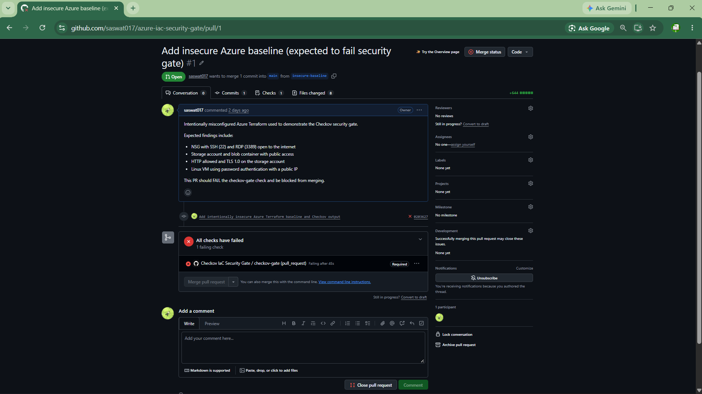
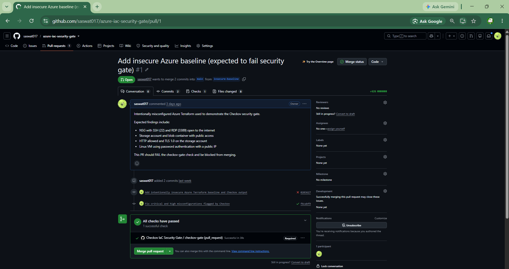
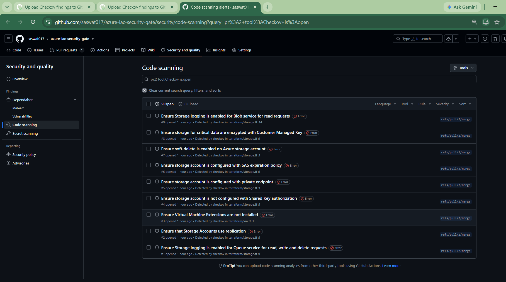

# azure-iac-security-gate

**Shift-left cloud security:** Terraform for Azure, scanned by Checkov in GitHub Actions, with insecure
pull requests blocked from merging.

## What it does

Every pull request that touches this repo is scanned by [Checkov](https://www.checkov.io/). If any
critical or high-risk misconfiguration is found (for example a public storage account or SSH open to
the whole internet), the `checkov-gate` check fails and a branch ruleset on `main` blocks the merge.
Lower-severity findings are listed in the log without blocking.

## Architecture

Developer opens a PR -> GitHub Actions runs Checkov on `terraform/` -> pass: merge allowed /
fail: merge blocked.

## What gets deployed (Terraform, Azure)

- Resource group and virtual network with a subnet
- Network security group attached to the subnet
- Storage account with a blob container
- Linux virtual machine with a network interface

## How the gate works

- **Full scan report** step: runs every Checkov check with `--soft-fail`, so all findings are visible.
- **Security gate** step: runs only 12 curated critical and high checks; any failure fails the job.
- Checkov is pinned to 3.4.5 so results are reproducible.
- `main` is protected by a ruleset: a PR is required and `checkov-gate` must pass. The bypass list is
  empty, so the rule applies to the repo owner too.
- Full scan results are uploaded as SARIF to GitHub's Security tab.

## Demo: fail, fix, pass

**1. Insecure PR is blocked.** The first commit deliberately contains public storage, SSH and RDP open
to `*`, TLS 1.0, password login and a public IP. The check fails and the merge button is disabled.



**2. The fix commit passes.** After removing RDP, restricting SSH to the VNet, making storage private,
enforcing TLS 1.2 and HTTPS, using SSH keys and dropping the public IP, the same PR turns green.



**3. All findings land in GitHub's Security tab.** The non-blocking full scan is uploaded as SARIF, so
every finding, including the medium and low ones the gate does not enforce, appears under
Security → Code scanning.



## Findings and risk

Every finding, the risk it represents, an attack scenario and the fix are documented in
[docs/findings.md](docs/findings.md). Raw first-scan output is in
[docs/checkov-insecure-output.txt](docs/checkov-insecure-output.txt).

## Run it locally

```bash
pip install checkov==3.4.5
checkov -d terraform
```

## Limitations and next steps

- Static scan of code only; it does not inspect live Azure resources.
- Medium and low findings are reported but not enforced.
- Possible additions: SARIF upload to GitHub's Security tab, a custom Checkov policy, and an AWS version.